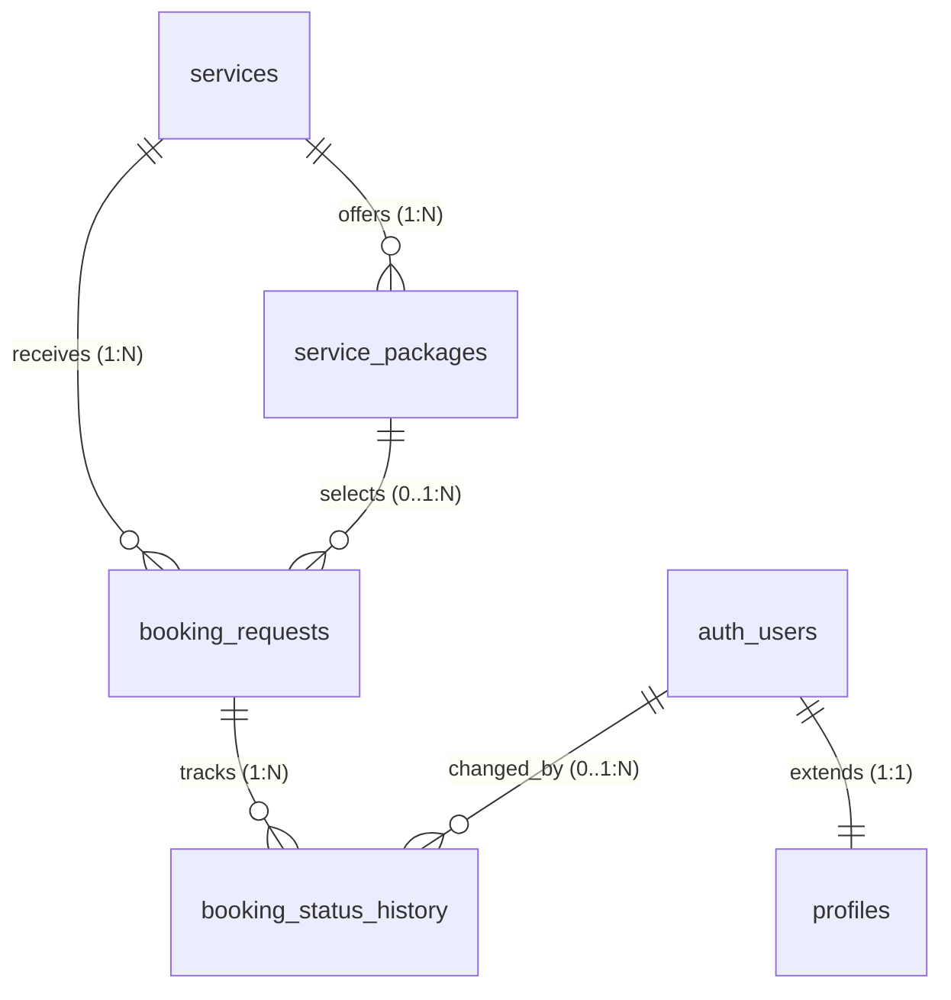

# Database Design & Schema Specification — FrameLearn

## 1. Milestone Status & Architectural Scope
With explicit lecturer approval, Milestone 002 transitions FrameLearn from a static UI presentation into a production-ready photography business platform for independent photographer Arafat Nabuku Jansu.

This document details the normalized relational database schema deployed via version-controlled SQL migration (`supabase/migrations/20261020000001_initial_schema.sql`), with explicit Row Level Security (RLS) policies and privacy safeguards.

---

## 2. Infrastructure Client Coordinates
The authoritative Supabase client is located at `src/lib/database/supabase.ts`. It consumes environment variables through `src/config/env.ts` with strict safety validation:
- `VITE_SUPABASE_URL`: Target Supabase project API endpoint.
- `VITE_SUPABASE_ANON_KEY`: Public anonymous API key.

If environment credentials are missing or set to placeholder templates, `isSupabaseConfigured()` gracefully halts unroutable remote requests, activates safe local mode, and warns via branded UI states without faking simulated database success.

---

## 3. Entity-Relationship Model (Milestone 002 Implementation)

The core relational database schema comprises 5 normalized entities:

---

## 4. Entity Specifications

### 4.1 `profiles`
- **Purpose**: Extends Supabase `auth.users` to record display names, contact information, and role-based permissions for authenticated platform operators.
- **Foreign Keys**: `id` references `auth.users(id)` ON DELETE CASCADE.
- **Fields**:
  - `id` (UUID, Primary Key, NOT NULL)
  - `role` (TEXT, NOT NULL, DEFAULT 'admin', CHECK `role IN ('admin', 'client', 'learner')`)
  - `full_name` (TEXT, NOT NULL)
  - `email` (TEXT, NOT NULL)
  - `phone` (TEXT, Nullable)
  - `avatar_url` (TEXT, Nullable)
  - `created_at` (TIMESTAMPTZ, NOT NULL, DEFAULT `NOW()`)
  - `updated_at` (TIMESTAMPTZ, NOT NULL, DEFAULT `NOW()`)
- **Triggers**:
  - `set_profiles_updated_at`: Automatically touches `updated_at` timestamp.
  - `on_auth_user_created`: Automatically provisions profile record on new user creation via `auth.users`.
- **Security & RLS**:
  - Enabled.
  - `SELECT`: Authenticated users can view their own profile (`id = auth.uid()`), or admins can view all (`is_admin()`).
  - `UPDATE`: Authenticated users can update their own details (`id = auth.uid()`), or admins can update all. Role escalation is blocked.

### 4.2 `services`
- **Purpose**: Defines canonical photography disciplines and creative service offerings managed by Arafat.
- **Fields**:
  - `id` (UUID, Primary Key, DEFAULT `gen_random_uuid()`)
  - `slug` (TEXT, NOT NULL, UNIQUE)
  - `name` (TEXT, NOT NULL)
  - `category` (TEXT, NOT NULL)
  - `description` (TEXT, NOT NULL)
  - `icon_name` (TEXT, Nullable)
  - `cover_image_url` (TEXT, Nullable)
  - `is_active` (BOOLEAN, NOT NULL, DEFAULT `TRUE`)
  - `sort_order` (INTEGER, NOT NULL, DEFAULT `0`)
  - `created_at` (TIMESTAMPTZ, NOT NULL, DEFAULT `NOW()`)
  - `updated_at` (TIMESTAMPTZ, NOT NULL, DEFAULT `NOW()`)
- **Indexes**: `idx_services_slug` ON `(slug)`, `idx_services_is_active` ON `(is_active)`.
- **Domain Rule**: Prices and package details are intentionally separated into `service_packages` to support multi-tier packages.
- **Security & RLS**:
  - `SELECT`: Public (anonymous + authenticated) can view active services (`is_active = TRUE`).
  - `INSERT / UPDATE / DELETE`: Strictly restricted to authenticated photographer/admin (`is_admin()`).

### 4.3 `service_packages`
- **Purpose**: Tiered packages for a specific service (e.g., Mini Session vs Full Day Coverage).
- **Foreign Keys**: `service_id` references `services(id)` ON DELETE CASCADE.
- **Fields**:
  - `id` (UUID, Primary Key, DEFAULT `gen_random_uuid()`)
  - `service_id` (UUID, NOT NULL)
  - `name` (TEXT, NOT NULL)
  - `slug` (TEXT, NOT NULL)
  - `description` (TEXT, Nullable)
  - `price_amount` (NUMERIC(10, 2), Nullable) — *Prices are NOT invented; they will be defined in Milestone 003.*
  - `currency` (TEXT, NOT NULL, DEFAULT 'GHS')
  - `duration_minutes` (INTEGER, Nullable)
  - `deliverables` (JSONB, NOT NULL, DEFAULT `'[]'::jsonb`)
  - `is_featured` (BOOLEAN, NOT NULL, DEFAULT `FALSE`)
  - `is_active` (BOOLEAN, NOT NULL, DEFAULT `TRUE`)
  - `sort_order` (INTEGER, NOT NULL, DEFAULT `0`)
  - `created_at` (TIMESTAMPTZ, NOT NULL, DEFAULT `NOW()`)
  - `updated_at` (TIMESTAMPTZ, NOT NULL, DEFAULT `NOW()`)
- **Constraints**: `UNIQUE (service_id, slug)`.
- **Indexes**: `idx_service_packages_service_id` ON `(service_id)`, `idx_service_packages_is_active` ON `(is_active)`.
- **Security & RLS**:
  - `SELECT`: Public can view active packages of active services.
  - `INSERT / UPDATE / DELETE`: Strictly restricted to authenticated photographer/admin (`is_admin()`).

### 4.4 `booking_requests`
- **Purpose**: Client session booking inquiries and requests.
- **Domain Rules**:
  - Public visitors can submit booking inquiries without creating an account.
  - Client personal identifiable information (PII) including email, phone, location notes, and session messages must NEVER be exposed publicly.
- **Foreign Keys**:
  - `service_id` references `services(id)` ON DELETE SET NULL.
  - `package_id` references `service_packages(id)` ON DELETE SET NULL.
- **Fields**:
  - `id` (UUID, Primary Key, DEFAULT `gen_random_uuid()`)
  - `service_id` (UUID, Nullable)
  - `package_id` (UUID, Nullable)
  - `client_name` (TEXT, NOT NULL, CHECK `char_length(trim(client_name)) > 0`)
  - `client_email` (TEXT, NOT NULL, CHECK email regex)
  - `client_phone` (TEXT, NOT NULL, CHECK `char_length(trim(client_phone)) >= 7`)
  - `preferred_date` (DATE, Nullable)
  - `preferred_time` (TEXT, Nullable)
  - `location_notes` (TEXT, Nullable)
  - `message` (TEXT, NOT NULL, CHECK `char_length(trim(message)) > 0`)
  - `status` (TEXT, NOT NULL, DEFAULT 'submitted', CHECK `status IN ('submitted', 'under_review', 'confirmed', 'declined', 'completed', 'cancelled')`)
  - `created_at` (TIMESTAMPTZ, NOT NULL, DEFAULT `NOW()`)
  - `updated_at` (TIMESTAMPTZ, NOT NULL, DEFAULT `NOW()`)
- **Indexes**: `idx_booking_requests_status`, `idx_booking_requests_created_at`, `idx_booking_requests_service_id`.
- **Security & RLS**:
  - `INSERT`: Open to public (both anonymous visitors and authenticated users).
  - `SELECT / UPDATE / DELETE`: Strictly restricted to authenticated photographer/admin (`is_admin()`). Anonymous users have zero read access, eliminating risk of client data scraping.

### 4.5 `booking_status_history`
- **Purpose**: Immutable audit log of status transitions on booking requests, capturing when a request moves from `submitted` to `under_review`, `confirmed`, `declined`, `completed`, or `cancelled`.
- **Foreign Keys**:
  - `booking_request_id` references `booking_requests(id)` ON DELETE CASCADE.
  - `changed_by` references `auth.users(id)` ON DELETE SET NULL.
- **Fields**:
  - `id` (UUID, Primary Key, DEFAULT `gen_random_uuid()`)
  - `booking_request_id` (UUID, NOT NULL)
  - `from_status` (TEXT, Nullable)
  - `to_status` (TEXT, NOT NULL)
  - `note` (TEXT, Nullable)
  - `changed_by` (UUID, Nullable)
  - `created_at` (TIMESTAMPTZ, NOT NULL, DEFAULT `NOW()`)
- **Indexes**: `idx_booking_status_history_request` ON `(booking_request_id)`.
- **Security & RLS**:
  - `SELECT / INSERT`: Strictly restricted to authenticated photographer/admin (`is_admin()`). Public has zero access.

---

## 5. Canonical Photography Services Registered

The initial migration idempotently registers Arafat Nabuku Jansu's 8 service disciplines (`ON CONFLICT (slug) DO NOTHING`):
1. **Portrait Photography** (`portrait-photography`): Professional studio and environmental portrait sessions.
2. **Graduation Photography** (`graduation-photography`): Academic cap, gown, family, and commemorative milestone coverage.
3. **Weddings & Event Photography** (`weddings-and-events`): Comprehensive traditional and modern ceremony coverage.
4. **Outdoor & Landscape Photography** (`outdoor-photography`): Natural lighting and environmental on-location photography.
5. **Birthdays & Celebrations** (`birthdays-and-celebrations`): Milestone birthdays, family reunions, and festive parties.
6. **Product & Commercial Photography** (`product-photography`): Commercial product and brand imagery.
7. **Photo Editing & Retouching** (`retouching-and-editing`): Color grading, skin retouching, and restoration.
8. **Photography Training & Workshops** (`photography-training`): Hands-on photography mentoring and lighting workshops.

*Note: Pricing details, deliverables packages, and duration options will be configured during Milestone 003 in collaboration with Arafat. No prices are invented.*

---

## 6. Data Retention, Security & Privacy Policy

1. **Client PII Shielding**: Client booking inquiries contain personal email addresses and telephone numbers. Under no circumstances does the frontend expose a public select query against `booking_requests`.
2. **Zero In-Repo Credentials**: All production keys and database passwords must reside in host environment variables or private secret vaults.
3. **Additive Migrations**: Schema alterations must use version-controlled SQL files under `supabase/migrations/` prefixed with timestamps. Destructive drop scripts are strictly prohibited.

---

## 7. Migration Security Hardening Audit (Verified Changes)

Prior to deployment to production project `htnquutikqahijrtvjsv`, an exhaustive SQL security review of `supabase/migrations/20261020000001_initial_schema.sql` was conducted. The following critical security fixes were implemented:

1. **Elimination of Signup Privilege Escalation**:
   - *Previous state*: `handle_new_user()` used `COALESCE(NEW.raw_user_meta_data->>'role', 'admin')`.
   - *Security vulnerability*: Any user signing up could assign themselves the `admin` role by submitting client-side metadata or relying on the unparameterized default.
   - *Remediation*: Default role is strictly `'client'`. Client-supplied role metadata is completely ignored. (Automatic first-user and hardcoded email promotions were subsequently eliminated in corrective migration `20261025000001_m002_corrective_hardening.sql`).
2. **Role Escalation Protection Trigger (`protect_profile_role`)**:
   - *Previous state*: User profile update policy allowed users to update their own row without preventing modification of the `role` column.
   - *Security vulnerability*: A malicious user could send `role = 'admin'` in an update query.
   - *Remediation*: Implemented the `protect_profile_role` trigger (`BEFORE UPDATE ON public.profiles`) which aborts with an exception if a non-administrator attempts to alter the `role` field.
3. **Search Path Hijacking Protection**:
   - *Previous state*: `SECURITY DEFINER` functions did not declare a fixed search path.
   - *Security vulnerability*: A malicious actor could create objects in schemas earlier in the search path to hijack execution.
   - *Remediation*: Enforced `SET search_path = public, pg_temp;` on `is_admin()`, `handle_new_user()`, `handle_updated_at()`, and `protect_profile_role()`.
4. **Cascading Service Package Visibility**:
   - *Previous state*: Public could view any package with `is_active = TRUE`.
   - *Remediation*: Policy now requires both `is_active = TRUE` and that the parent service is active (`s.is_active = TRUE`), ensuring that archiving a service automatically isolates its packages.
5. **Audit Attribution**:
   - Enforced `booking_status_history.changed_by` default to `auth.uid()`.
6. **Explicit Schema Grants**:
   - Revoked public execution grants on internal triggers and helper functions; explicitly granted only required table permissions to `anon` and `authenticated`.

---

## 8. Milestone 002 Corrective Hardening & Performance Optimization

Applied via version-controlled migration `supabase/migrations/20261025000001_m002_corrective_hardening.sql`:

1. **Complete Removal of Automatic Admin Promotion**:
   - Removed the first-registered-user promotion rule (`is_first_user`).
   - Removed the hardcoded email promotion rule (`LOWER(NEW.email) = 'arafat@framelearn.com'`).
   - Public registrations unconditionally receive `'client'`. Administrator provisioning requires an authorized database owner to update the profile explicitly.
2. **SECURITY DEFINER Function ACL Hardening & Controlled Provisioning**:
   - `public.handle_new_user()`: Execution revoked from `PUBLIC`, `anon`, and `authenticated`. Granted exclusively to `supabase_auth_admin`, `service_role`, and `postgres`.
   - `public.protect_profile_role()`: Execution revoked from `PUBLIC` and `anon`. Permitted for `session_user IN ('postgres', 'supabase_admin')`, `service_role`, or verified administrators via `is_admin()`, while strictly blocking role escalation attempts from client application requests.
   - `public.assign_admin_role(target_email text)`: Dedicated administrative procedure for establishing the photographer administrator. Revoked from `PUBLIC`, `anon`, and `authenticated`; granted exclusively to `postgres` (Dashboard SQL Editor) and `service_role`.
   - `public.is_admin()`: Execution revoked from `PUBLIC` and `anon`. Granted to `authenticated`, `service_role`, and `postgres`. Recognizes `auth.role() = 'service_role'` as administrative context.
3. **Covering Indexes on Foreign Keys (Performance Advisor Remediation)**:
   - Added `idx_booking_requests_package_id` on `public.booking_requests(package_id)`.
   - Added `idx_booking_status_history_changed_by` on `public.booking_status_history(changed_by)`.
4. **RLS InitPlan Optimization & Policy Consolidation**:
   - Wrapped `auth.uid()` in `(SELECT auth.uid())` across profile policies to permit PostgreSQL initPlan statement caching.
   - Consolidated `profiles_update_own` and `profiles_update_admin` into a single policy `profiles_update_own_or_admin` to eliminate multiple permissive update policy warnings.
   - Partitioned `services` and `service_packages` SELECT policies into separate `anon` and `authenticated` rules so anonymous queries evaluate `is_active = TRUE` directly without invoking `is_admin()`.
5. **Retention Justification for Unused Indexes**:
   - Indexes on slugs, active states, and timestamps currently report 0 scans due to minimal pre-production traffic. They are retained because they provide necessary indexed lookups for Milestone 003 filtering and Milestone 004 booking workflows.
6. **Migration History Reconciliation**:
   - Reconciles `supabase_migrations.schema_migrations` with versions `20261020000001` and `20261025000001` without fabricating tables.

